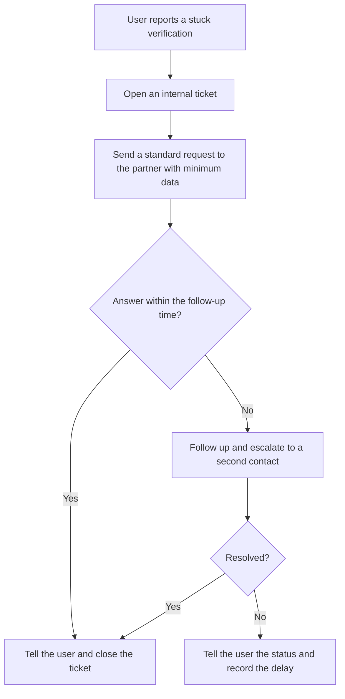

# Case Study: Stuck KYC Verifications and Escalation to Third Parties

**Note:** This is an illustrative, composite case based on everyday support work in a non-custodial fintech app. It contains no real customer data, numbers, dates, or partner names. It is written from practical experience, not from a formal framework.

## 1. The Situation

In this kind of app, identity verification (KYC) is not done by the app itself. It is done by regulated partners, called *anchors*. When a user's verification gets stuck, the user can't move forward, and the app can't fix it directly.

The user writes to the support team. The team can't approve or reject anything. What it can do is pass the problem to the right partner and follow up.

## 2. How It Works Today

When a user reports a stuck verification, the usual steps are:

1. Register the case in an internal ticket, so there is a record.
2. Forward the problem to the partner that runs the verification.
3. Follow up until the partner answers, then tell the user.

The second step is where it gets complicated. Each partner has its own way of receiving requests: some by email, some through a shared chat channel, and some use both. There is no single way to do it.

## 3. Why It Matters

This looks like routine support, but it carries several risks that are easy to miss:

- **Dependency on someone else.** The app doesn't control the partner's timing or decisions. A user can wait a long time with no way for the app to speed things up.
- **Personal data in many places.** Sending identity details by email or chat means personal data travels through different channels, and it is not always clear who can see it afterwards.
- **Gaps in the record.** If a request goes by chat or email and the ticket isn't updated, the app can't later prove what was sent, when, and to whom.
- **Different handling per partner.** The same type of problem is handled differently depending on the channel, so results depend on who happens to be on duty.
- **Impact on real people.** A person who can't finish verification can't use the service, and may lose trust in it.

## 4. What Could Make It Better

- **One record for every case.** Whatever channel is used, the ticket should show what was sent, when, and the answer received.
- **Send only what is needed.** A short standard message with the minimum data the partner needs, instead of forwarding the user's whole message.
- **Prefer the safest channel each partner offers.** If a partner accepts requests in a controlled system, use that over informal chat.
- **A follow-up time.** If there is no answer after a set period, the case is chased again or raised to someone else.
- **Clear wording for users.** Tell users what is happening, who is deciding, and a realistic idea of the wait, without promising what only the partner can decide.
- **Spot patterns.** If many cases get stuck for the same reason with the same partner, that is a signal for the app to raise the issue with the partner, not only handle each case alone.

## 5. Simple Flow

## 6. What Would Be Worth Measuring

- How long cases take from report to resolution, by partner.
- How many cases need a second follow-up.
- The most common reasons for stuck verifications.
- How often the ticket and the partner conversation match.

These numbers would show where the process is slow or inconsistent. This case doesn't claim any figures.

## 7. Lessons Learned

- When a key step depends on a partner, the app's job is to manage the relationship well: clear requests, records, and follow-up.
- Personal data deserves attention at every step, including informal ones like a forwarded message.
- A process that works "because the right person is on duty" is fragile. Standard steps make it reliable.
- Users judge the whole service by how their problem is handled, even when the delay is not the app's fault.
