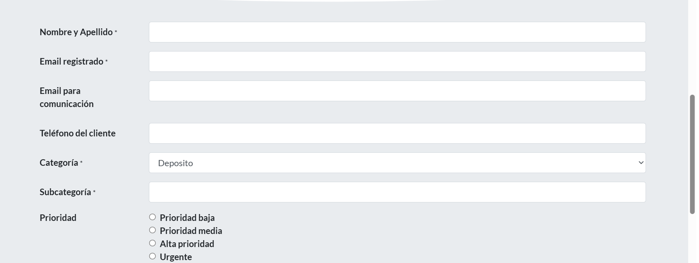

![image alt] https://github.com/fpaterson/grc-portfolio/blob/4229623d90fa781527b12694d98f15d26faf6006/case-studies/04-kyc-delays-third-party-escalation/images/partner_request_form.png

## Partner Support Request Form

Screenshot of a blank request form (in Spanish) used to pass a stuck verification to a partner.
- Shows the kind of information a partner usually asks for: the user's name, registered and contact emails, phone number, category, subcategory, and priority.
- No real data is shown; partner and company details are removed.
